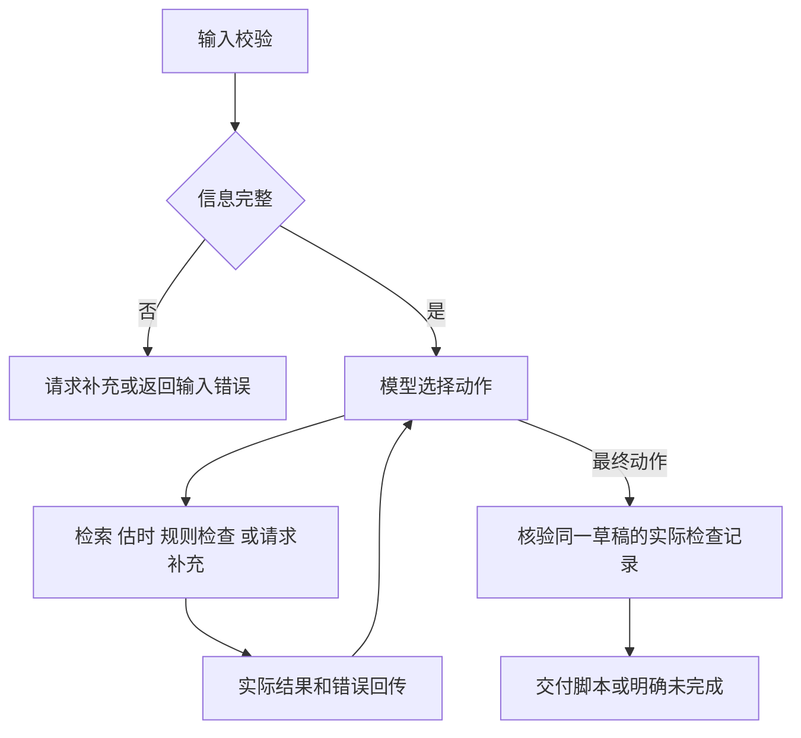

# 方案

## 调用流程

图中的工具节点是一组可选动作，真实模型没有固定分支脚本。首稿或修订稿均由模型通过 `estimate_duration` 提交；工具负责计算与记录，不代替真实模型生成文案。

有 `initial_draft` 时，提示要求先检索并诊断原稿，再由模型依据超时或规则反馈决定是否压缩、重写或停止。最终稿仍需同一版本的实际复检。真实记录中的原稿从 14.2 秒压缩至 8.3 秒，具体输入、动作和检查见 [审核补强](13-review-strengthening.md)。

## 模块职责

| 模块                     | 职责                                             |
| ------------------------ | ------------------------------------------------ |
| `src/main.py`            | CLI、运行模式、输入与配置错误、退出码            |
| `src/video/schemas.py`   | 请求、草稿和最终动作 Schema                      |
| `src/video/catalog.py`   | 校验合成资料、限定产品检索、返回事实原文         |
| `src/video/checks.py`    | 估时、来源覆盖、数值与品牌规则                   |
| `src/video/tools.py`     | 工具注册、草稿内容标识、检查记录与最后核验       |
| `src/video/service.py`   | 组合模型、工具、预算与业务状态                   |
| `src/video/offline.py`   | 只用于离线验收的确定性模型替身                   |
| `src/agent/`             | 通用循环、输出校验、暂停与继续、失败恢复及 Trace |
| `src/llm/`、`src/tools/` | 模型适配、协议和通用工具执行                     |

## 关键决策

工具绑定经过校验的请求与指定产品，模型不能通过工具参数提高目标时长或切换产品。用户请求只作为用户消息提供，产品主张不能自动成为素材事实。

草稿以规范 JSON 的 SHA-256 作为标识。任何修改都会改变标识，必须重新估时并检查。最终模型只返回已检查的标识，程序根据实际保存的草稿与计算结果组装脚本；不会采用模型自行声明的总时长、引用清单或“已通过”字段。

业务层默认最多 10 个工具轮次、14 次模型请求、16 次实际工具执行，活跃时间预算为 180 秒。保留通用模块原来的默认配置，业务单独设置预算以容纳修订与复检。

事实校验采用素材原文与获准过渡语组合，避免仅凭“存在来源 ID”就认定产品主张可信。该约束适合当前小规模演示，会牺牲自由文案能力；改写的语义正确性不在确定性检查能力之内。

镜头类型覆盖标题、界面演示、界面特写、步骤、回顾和结束卡。模型依据风格选择结构；速览提示避免重复事实，教学允许必要的示范和字幕回顾。起止时间由实际估时结果计算，不能由模型自行声明。

## 状态与验证边界

顶层 `completed` 代表业务最终检查通过。嵌套 `runtime.status` 只表示模型循环状态，可能已经结束，但业务层因缺少检查记录而仍返回 `incomplete`。`needs_input` 表示信息不足；`invalid_input`、`configuration_error`、`model_error`、`cancelled` 分别保留相应失败边界。

输出保留 `trace`、完整 `tool_records` 和各版 `drafts`，用于逐条核对工具参数、目的、结果、修订与最终交付。模型内部思维过程不记录。

离线替身根据真实本地工具的返回结果进入不同验收路径，它仍是确定性程序。真实入口已用 DeepSeek `deepseek-flash` 完成验收，原始记录与失败修复见 [截点后验收](12-post-checkpoint-acceptance.md)。业务请求启用 JSON object 输出模式，格式错误的修复反馈启动新的 user 回合，仍需通过本地 Schema 与最终业务检查。详细规则见 [业务说明](09-business-rules.md)，通用超时与内存状态限制见 [Agent 能力](08-runtime-capabilities.md)。
