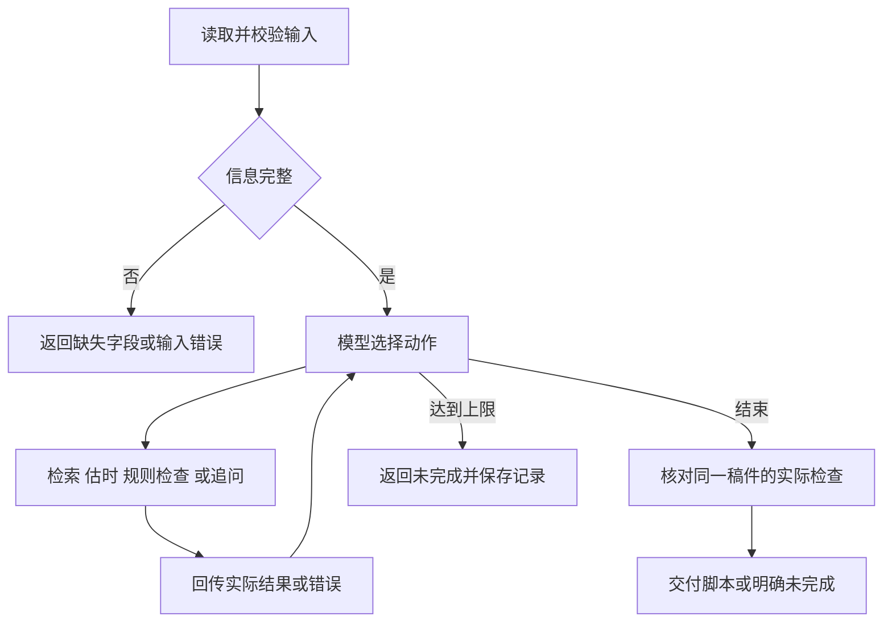

# 方案与技术取舍

程序采用有次数上限的模型工具循环。模型每次决定调用什么工具，程序执行后把结果送回模型，直到得到可交付结果、需要补充信息或明确停止。真实路径没有预写分支答案。

## 调用流程

检索工具绑定请求中的产品 ID，估时工具绑定时长上限。模型不能通过参数换产品或放宽时长。已有稿件先作为待检查输入，检索与诊断后再决定是否修改。

## 动态决策

| 实际观察                             | 模型随后采取的动作                    | 证据                                                                               |
| ------------------------------------ | ------------------------------------- | ---------------------------------------------------------------------------------- |
| 首次检索工具抛出注入异常             | 改用 `P01` 查询，恢复后继续估时和检查 | [工具失败路径](../examples/live/20261029-strengthening/tool-failure.output.json)   |
| 多次检索没有素材                     | 继续改写查询，仍无依据后请求补充资料  | [无素材路径](../examples/live/20261029-strengthening/no-materials.output.json)     |
| 旧稿估时 14.2 秒，超过新的 10 秒上限 | 改为三镜头，压缩至 8.3 秒，再检查引用 | [压缩路径](../examples/live/20261029-strengthening/duration-repair.output.json)    |
| 教学稿规则检查失败                   | 修改不合规文案，重新估时并检查后交付  | [规则修订路径](../examples/live/20261029-strengthening/style-tutorial.output.json) |

这些记录使用真实模型，工具故障由宿主端明确注入。Trace 保存步骤、动作目的、参数和结果摘要；`tool_records` 保存完整回执，`drafts` 保存各版候选稿。模型内部思维过程不导出。

## 模块与职责

| 模块                     | 职责                                       |
| ------------------------ | ------------------------------------------ |
| `src/main.py`            | CLI、输入读取、模式选择和退出码            |
| `src/config.py`          | 进程环境配置、参数校验及可公开设置         |
| `src/video/catalog.py`   | 合成资料校验、产品隔离和检索               |
| `src/video/checks.py`    | 确定性估时、来源覆盖和品牌检查             |
| `src/video/tools.py`     | 保存草稿与回执，组装最终脚本               |
| `src/video/service.py`   | 接入模型、工具、运行限制和业务状态         |
| `src/video/offline.py`   | 明确标记的离线模型替身                     |
| `src/agent/`             | 循环、输出修复、补充信息后的继续执行和统计 |
| `src/llm/`、`src/tools/` | Responses API 适配与通用工具执行           |

## 技术取舍

技术路线选择复用已有 AI-demo 中熟悉的部分，保留同步模型请求和本地工具调用。这里的流程较短，用现有代码可以直接检查消息、参数、错误回传和结束条件。没有引入 Google ADK、AgentScope 或 LangGraph 等完整框架，也没有迁移原项目的终端界面、Tokenizer 和本地 Token 预算器。来源版本与裁剪内容见[迁移说明](07-migration.md)。

| 依赖              | 固定版本 | 承担的工作                            |
| ----------------- | -------- | ------------------------------------- |
| OpenAI Python SDK | 2.53.0   | 通过 Responses API 发送请求和工具结果 |
| HTTPX             | 0.28.1   | SDK 传输配置与模拟 HTTP 测试          |
| jsonschema        | 4.26.0   | 请求、工具参数和模型输出的结构校验    |

程序用内容哈希生成 `draft_id`。修改任意内容都会产生新标识，最终交付必须找到同一版本通过的估时和规则回执。总时长、来源清单和起止时间由程序从检查结果组装，不能靠模型自行声明通过。

产品表述只允许检索到的事实原文与获准过渡语。这种办法能检查引用是否实际支持文本，也会拒绝不少正确的同义改写。本次优先保证事实可追溯，暂时接受自由表达受限的取舍。

## 结束条件与边界

业务默认最多 10 个工具轮次、14 次模型请求、16 次业务工具执行，默认活跃时间为 180 秒。真实验收通过配置把时间上限改为 600 秒，次数限制仍保留。达到上限返回 `incomplete`，不会交付未检查的脚本。

`runtime.status` 只描述模型循环状态。顶层 `completed` 还要通过业务最终检查；需要补充信息时返回 `needs_input`，输入错误、模型错误和取消各有明确状态。

业务请求启用 JSON object 输出模式，本地仍检查 Schema。最终格式有误时，修复反馈开启新的 `user` 回合，避免续接已经结束的工具回合。真实出现过的 HTTP 400 及修复记录见[截点后验收](12-post-checkpoint-acceptance.md)。

暂停状态只保存在内存中，本地同步工具也无法被强制中断。这些能力的具体边界保留在[运行时说明](08-runtime-capabilities.md)。
